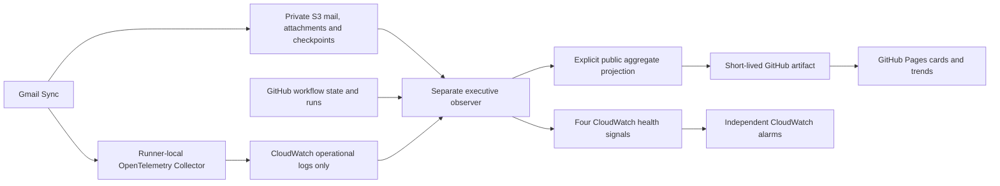
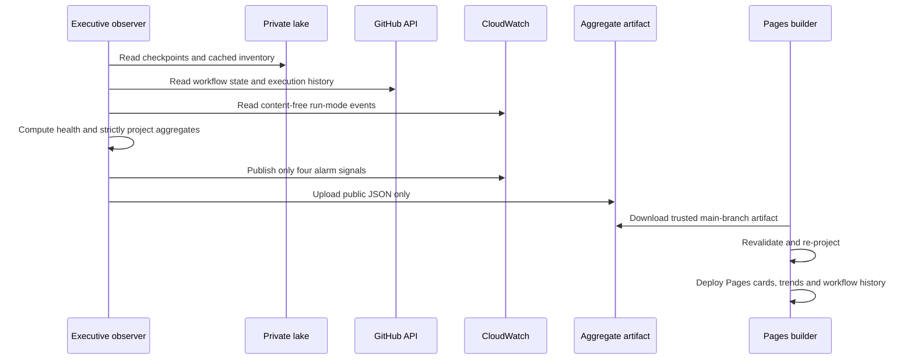

# Mail lake observability — low-cost Pages profile

[Open the executive dashboard](https://considerable.github.io/mail-parquet-lake/).

The executive view is hosted on **GitHub Pages** alongside workflow history.
CloudWatch retains content-free operational logs and **four health-alarm metrics**.
Business inventory cards and charts no longer publish CloudWatch custom metrics.
Cost Explorer queries and AWS trace export are disabled. The previous
`MailLake-Executive` CloudWatch dashboard is retired during migration.

## Architecture



The observer never reads Gmail or changes ingestion checkpoints. Inventory reads
and small aggregate caches use the existing private S3 lake. No Lambda, EC2,
external database, new access key or permanent Collector server is introduced.

## Public data and privacy

The public `executive.json` contains only an explicit allowlist:

- Observation and measurement timestamps; derived health status and fixed reasons.
- Total email rows, linked attachment count and stored GiB.
- Backfill scanned/captured counts, completion flag and last checkpoint time.
- Gmail workflow enablement and aggregate classified execution outcomes.
- Up to 30 dated inventory observations, without fabricated missing-day values.

No mail bodies, subjects, addresses, filenames, attachment bytes, Gmail IDs,
thread IDs, bucket names/keys, AWS account IDs/ARNs, credentials, raw exceptions,
private reports or arbitrary source strings are published. This is **public
aggregate data**, not a private dashboard hidden behind an unlisted URL.

[public_executive.py](../scripts/public_executive.py) projects source evidence
into the public schema. The Pages builder downloads only a successful observer
artifact from this repository's `main` branch and exact executive workflow path,
then projects it again. Invalid timestamps, non-finite/negative numeric values,
unknown schemas and untrusted workflow sources cannot create healthy evidence.
Free-form artifact health/reason strings are ignored and recomputed from selected
fields. A missing or rejected artifact produces an unavailable-state page.

The observer uploads **only** `/tmp/executive-public.json` as
`mail-lake-executive-public`, retained for two days. Its private diagnostic output
is a different file and is never uploaded. Do not add private snapshots or raw
job artifacts to `dashboard/`.

## Executive indicators

| Indicator | Meaning |
|---|---|
| Overall health | Critical for overdue mailbox sync or a disabled workflow; unknown if required evidence is unavailable; attention during incomplete backfill or stale inventory; healthy requires all required evidence |
| Emails stored | Committed rows across monthly Parquet partitions, not a Gmail mailbox-size estimate |
| Linked attachments | Sum of committed rows' `attachment_count`; unassessed legacy fields are not counted, so incomplete backfill can undercount eventual coverage |
| Stored size | Email Parquet and attachment objects including manifests, excluding operational reports, in GiB |
| Last successful sync | Successful full/incremental checkpoint; historical backfill and telemetry checks cannot reset freshness |
| Attachment completeness | Persisted scanned/file totals, completion flag and progress timestamp; incomplete does not mean a job is currently running |
| Reliability | Classified real-sync successes/failures over 30 days; probes, cancelled/running/skipped and unclassified legacy runs excluded |
| Inventory trends | Dated inventory values, not counts of processing attempts; measurement date is preserved even when a cached value is reused |
| Cost controls | Explains disabled exporters/queries and remaining cost exposure; never claims a measured $0 bill |

A successful backfill pass may stop at its time budget with work remaining.
No completed classified real runs means reliability is **unknown**, not 100%.
Old mode-less jobs are classified only if their `run_started` log supplies a
trustworthy run ID/mode; excluded legacy-run counts are shown. New run titles
include their mode. Historical coverage is consequently explicit and can be partial.

### Freshness and staleness

Successful full/incremental writes include `last_success_at` in `sync_state.json`.
Legacy state falls back to the S3 object's modification time, which is an inference
and could be affected by a manual rewrite. No checkpoint timestamp is reset to
make the dashboard green.

The deadline follows Gmail's existing UTC cron slots plus a **90-minute completion
allowance**: every day 10:00 UTC; weekdays 14:00/18:00/22:00 UTC;
Tuesday–Saturday 00:00 UTC. Update `latest_due()` and its tests if that schedule
changes. This accounts for overnight/weekend gaps instead of using an incorrect
fixed daytime threshold.

The browser checks the executive timestamp every minute and replaces health with
**Stale data** after 45 minutes. Invalid, missing or future timestamps show
unavailable evidence. Old inventory cards retain their measurement date; missing
values are not turned into zero. This works even if the publishing workflow has
stopped, provided the page can still load. It does not send a notification.

## Collection and publication



[Executive Observability](../.github/workflows/executive.yml) runs at UTC minutes
11/26/41/56, after Gmail Sync finishes, and manually. It has its own concurrency
group and always uses trusted `main` source. A failure/disablement of Gmail Sync
does not stop its observer. Pages refreshes on observer completion, other
operational completions, and roughly every 30 minutes. GitHub schedules can be delayed.

Inventory refreshes **daily**, or on explicit `refresh_inventory`. It spans
multiple S3 reads while writers may advance, rather than an atomic bucket
snapshot. Private aggregate caches remain at:

- `<prefix>/reports/executive-inventory.json`
- `<prefix>/reports/executive-status.json`

Daily history uses the inventory measurement day, not the collector refresh day.
Dates without measurements remain absent; a single point is not presented as a
growth trend. The workflow history and executive snapshots have separate timestamps.

## Four independent CloudWatch alarms

Only these series are published to `MailParquetLake/Executive`:

| Metric | Alarm | Condition |
|---|---|---|
| `ObserverHeartbeat` | `MailLake-Executive-ObserverMissing` | Missing/below-one heartbeat for two 15-minute periods |
| `SyncOverdue` | `MailLake-Executive-SyncOverdue` | Schedule-based freshness overdue or unavailable |
| `SourceErrors` | `MailLake-Executive-SourceUnavailable` | Required operational source unavailable |
| `SyncWorkflowActive` | `MailLake-Executive-SyncDisabled` | Workflow disabled/removed or state unavailable |

All use standard-resolution 15-minute periods and missing data as breaching.
Alarms evaluate in AWS independently of GitHub. The heartbeat covers evidence
collection, **not** successful artifact upload or Pages deployment; browser
staleness and the Dashboard job expose delivery failures. Alarm evaluation can
lag; this is not instantaneous outage detection.

There are **no SNS subscriptions, email notifications or alarm actions**. Inspect
alarm states in the private CloudWatch console. Add a notification route only
when explicitly chosen.

## OpenTelemetry logs-only default

Gmail Sync sends explicit logs over OTLP/HTTP to a Collector in a Docker container
on the GitHub runner, at `http://127.0.0.1:4318`. That address is the temporary
runner, not this Mac or a permanent AWS server. The workflow starts the Collector,
checks health, flushes Python logs, then stops/removes the container.

Logs go to `/mail-parquet-lake/otel` in `us-west-2`, stream
`github/<run-id>/<attempt>`, with 30-day retention. Only the dedicated telemetry
logger is exported. Exception messages/stacks, HTTP request bodies and mail
content are excluded. Events include `run_started`, `run_finished`, `run_failed`,
`operation_failed`, `backfill_progress` and `telemetry_check_passed`.

`LAKE_METRICS_ENABLED=0` and `LAKE_TRACES_ENABLED=0` are explicit workflow settings
and defaults. The Collector has **no EMF metrics or X-Ray trace pipeline**. Thus
old business counters/histograms and trace spans stop exporting. Historical
CloudWatch metric series/traces remain until AWS retention expires; stopping
publication cannot erase earlier charges. Optional SDK support remains in source,
but enabling it needs a separately configured destination and cost review.

Queries for operational logs, in CloudWatch Logs Insights:

```sql
fields @timestamp, body, attributes.mode, attributes.scanned,
       attributes.attachments, attributes.complete
| filter body in ["run_failed", "operation_failed", "backfill_progress"]
| sort @timestamp desc
| limit 100
```

Logs Insights queries themselves can incur scan charges. This Pages dashboard
does not run them or render paid CloudWatch metric images.

## Cost boundary

This targets a low-cost observability footprint; **it cannot guarantee a $0 AWS
bill**. Account-wide free allowances are shared with other applications/regions.
Remaining exposure includes four custom health series and four alarm metrics,
CloudWatch log ingestion/storage, S3 storage/requests for the lake and inventory,
and any GitHub usage outside public-repository standard-runner allowances.

Removed ongoing costs/features: business-metric publishing, EMF conversion,
AWS trace export, Cost Explorer API calls and CloudWatch dashboard/chart rendering.
Inventory is daily to bound reads. No zero-spend value is inferred, and existing
charges are not reversed. AWS billing console remains the source for the actual bill.

The log group retains AWS-managed encryption. A customer-managed KMS key is
**disabled by default** in Terraform (`enable_customer_managed_log_key=false`).
No key was created as part of this migration. Do not toggle that option without
accepting its extra cost and key-retention responsibilities. Existing logs and
mail objects are preserved.

## Deployment and maintenance

[executive-policy.json](../observability/executive-policy.json) now allows metric
writes only to the executive namespace plus reads of the mail-lake log group.
Cost Explorer reads and CloudWatch dashboard writes are removed. Existing scoped
S3 access is reused. The telemetry role's trace-write permission is retired.
The Pages build gets no AWS credentials, only its GitHub read token.

```sh
# Maintain the four console-only alarms and narrowed observer policy.
python scripts/deploy_executive.py --apply

# Collect evidence, generate a public projection and publish four alarm metrics.
python scripts/collect_executive.py --publish --public-output /tmp/executive-public.json

# Preview retirement of the old CloudWatch view and trace permission.
python scripts/migrate_pages_profile.py
# Apply only those narrowly named retirement changes.
python scripts/migrate_pages_profile.py --apply
```

Use Actions → **Executive Observability** → Run workflow for a refresh; select
`refresh_inventory` only when a new S3 measurement is needed. **Dashboard** builds
and deploys the public site after a successful observer artifact exists. A rejected
or missing artifact shows unavailable evidence and does not block workflow history.

Implementation and tests:

- [Health policy](../scripts/executive_dashboard.py), [collector](../scripts/collect_executive.py), and [public projection](../scripts/public_executive.py).
- [Pages builder](../scripts/build_dashboard.py) and [executive frontend](../dashboard/executive.js).
- [Telemetry](../sync/telemetry.py) and [logs-only Collector](../observability/collector.yaml).
- [Executive tests](../tests/test_executive.py), [artifact/privacy tests](../tests/test_dashboard.py), and [exporter guards](../tests/test_telemetry.py).

Terraform declares the four alarms and role policy in
[infra/executive.tf](../infra/executive.tf); it no longer creates a CloudWatch
dashboard. Import directly provisioned resources before managing them with
Terraform, and review existing bucket/prefix variables before any apply. Do not
apply unrelated infrastructure as part of a dashboard refresh.

Workflow actions remain pinned by full commit. Python Dependabot updates have a
seven-day cooldown; Actions does not support cooldown, so only that unsupported
scanner rule has a documented ecosystem exception. Standard secret, SAST,
dependency, lint and test checks remain enabled for all PRs. Optional cloud-backed
AI reviews run only for trusted same-repository human PRs, not Dependabot/forks.
