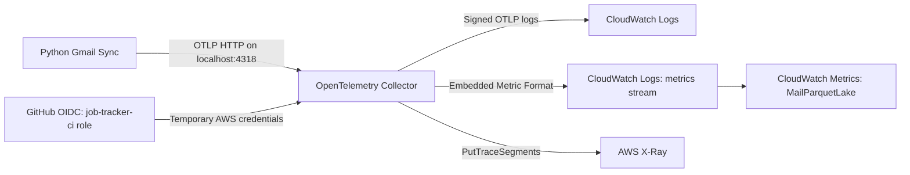
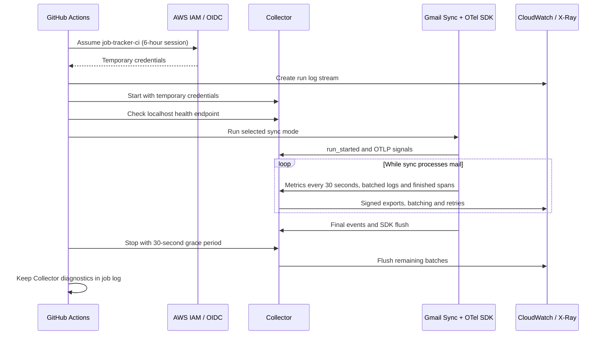
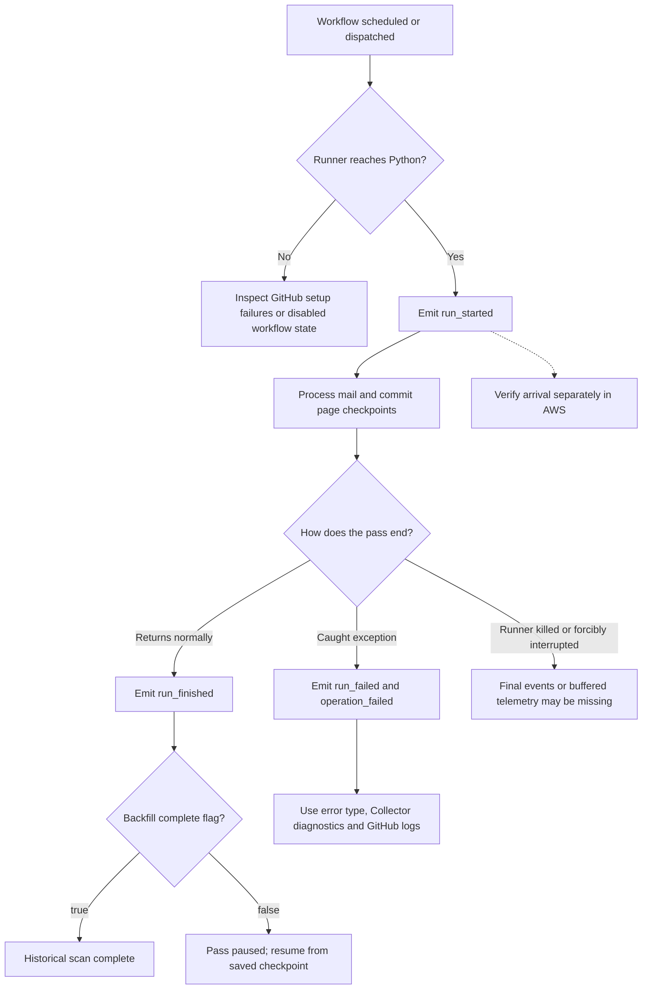

# OpenTelemetry setup for mail-parquet-lake

Gmail Sync emits explicit OpenTelemetry signals over OTLP/HTTP to a Collector
on its GitHub runner. The Collector uses the workflow's temporary OIDC role
credentials. There are no new access keys or bearer tokens.

This setup instruments **Gmail Sync**: full imports, incremental sync and
attachment backfill. It does not automatically instrument Job Tracker, the
GitHub Pages collector, or GitHub Actions platform events.

## Contents

- [Architecture](#architecture)
- [Destinations](#destinations)
- [Workflow lifecycle and configuration](#workflow-lifecycle-and-configuration)
- [Signals and meaning](#signals-and-meaning)
- [Reliability and limitations](#reliability-and-limitations)
- [Verify and query](#verify-and-query)
- [Troubleshooting](#troubleshooting)
- [Infrastructure](#infrastructure)
- [Implementation files](#implementation-files)

## Architecture



The Python SDK produces the telemetry. The Collector batches and routes it;
CloudWatch and X-Ray store and query it. The Collector is not the dashboard or
the long-term store. The email lake itself continues to store mail and attachment
bytes in S3, independently of telemetry.

## Destinations

- **Logs:** `/mail-parquet-lake/otel` in `us-west-2`, stream
  `github/<run-id>/<attempt>`. Fixed event names plus counts, mode and run ID.
- **Metrics:** OpenTelemetry counters/histograms are converted to CloudWatch
  Embedded Metric Format (EMF) in the same group, stream `metrics`. CloudWatch
  extracts them into namespace `MailParquetLake`. This deliberately uses EMF
  rather than the separate native OTLP metrics store to keep metric source data
  in the requested log group and support classic CloudWatch dashboards.
- **Traces:** the Collector's AWS X-Ray exporter sends to the existing regional
  X-Ray destination. These are not stored in the chosen log group. Logs emitted
  within spans carry trace/span context for correlation. No account-wide
  Transaction Search destination change is required or made.

Log retention is 30 days. Terraform now declares a customer-managed KMS key
`alias/mail-parquet-lake-otel`, scoped to this group, with automatic key rotation.
The live group still uses AWS-managed encryption until the proposed key and IAM
changes receive explicit approval and are applied. Existing log events retain
their original encryption when a key is associated. This does not set metric or trace
retention. Ingestion, custom metrics and trace storage can incur AWS charges.

## Workflow lifecycle and configuration

The [Gmail Sync workflow](../.github/workflows/gmail-sync.yml) performs these steps:

1. Check out the code and assume `job-tracker-ci` through GitHub OIDC.
2. Request a six-hour AWS session and install the Python dependencies.
3. Create the run's CloudWatch log stream and start the Collector container.
4. Wait for the Collector's local health endpoint, then run the selected sync mode.
5. Flush Python telemetry on exit; stop the Collector with a 30-second grace
   period, print its diagnostic logs to the GitHub job log, and remove it.




The Collector is version `0.164.0`, pinned to an image digest in the workflow.
It receives OTLP/HTTP, not OTLP/gRPC. Although its listeners use `0.0.0.0`
inside the container, Docker publishes them only on the runner's loopback address.

| Setting | Current value / purpose |
|---|---|
| `LAKE_TELEMETRY_ENABLED` | `1` enables the Python exporters; otherwise instrumentation is inactive |
| `OTEL_EXPORTER_OTLP_ENDPOINT` | `http://127.0.0.1:4318`, the local Collector |
| `AWS_REGION` | `us-west-2` |
| `CLOUDWATCH_LOG_GROUP` | `/mail-parquet-lake/otel` |
| `CLOUDWATCH_LOG_STREAM` | `github/<run-id>/<attempt>`, assigned at startup |
| Service name | `mail-parquet-lake` |
| Service version | GitHub commit SHA, or `local` outside Actions |
| Metric export interval | 30 seconds, plus final flush |
| SDK log/span queues | Up to 512 entries each; export batches up to 64 |
| Collector batching | Five-second timeout; target 64, maximum 128 entries |
| Collector memory limiter | 192 MiB limit, 48 MiB spike allowance |
| Container memory limit | 384 MiB |

The resource includes the service name, version and deployment environment.
The dedicated logger adds the workflow run ID. Metric dimensions remain bounded:
`mode` and, for operation metrics, `operation`; run IDs and commit SHAs are not
configured as CloudWatch metric dimensions.

## Signals and meaning

| Signal | Meaning |
|---|---|
| `run_started`, `run_finished`, `run_failed` | Python process lifecycle; successful completion of a pass is not necessarily completion of the entire historical backfill |
| `backfill_progress` | Cumulative committed scanned messages, attachment-bearing emails, files and completion flag from the persisted checkpoint |
| `lake_messages_scanned` | Backfill references scanned this process |
| `lake_email_rows_upserted` | Email upserts after successful partition writes; reprocessing may count a row again |
| `lake_attachments_stored` | Files in newly committed manifests; cached manifests are not counted again |
| `lake_attachment_bytes_stored` | Bytes in those newly committed manifests |
| `lake_gmail_fetch_retries` | Retries in individual message fetches; not all SDK-internal retries |
| `lake_runs_started/finished/failed` | Process counts by mode |
| `lake_operation_failures` | Failed instrumented operations |
| `lake_operation_duration_seconds` | Instrumented run/page-commit duration |
| `lake_telemetry_checks` | Isolated connection tests, mode `telemetry-check` |

Root run spans finish when the pass ends; page-commit spans can arrive while a
long run is still active. The backfill's content fetch/upload work is within the
run span; page spans measure only its Parquet commit phase. No per-email spans
are created. Metrics use bounded `mode` and, where present, `operation`
dimensions. Run IDs are log properties, not metric dimensions.

Only the dedicated telemetry logger is exported. Email addresses, subjects,
bodies, filenames, attachment bytes, Gmail IDs, S3 keys, credentials and exception
messages/stacks are not captured in telemetry. Original GitHub stdout remains a
separate job log. Do not enable broad automatic HTTP/boto3/logging capture without
reviewing its attributes first.

## Reliability and limitations

Counters and histograms export deltas, so final flushes do not duplicate
cumulative duration observations. The Python SDK and Collector use bounded
memory queues, batching and retry backoff. SDK exporters time out after five
seconds; the HTTP logs exporter retries
for up to one minute. Shutdown flushes SDK queues and gives the Collector 30
seconds to stop. Runner termination can still lose buffered telemetry; this is
not a durable audit pipeline. Telemetry delivery errors are visible in Collector
logs. A healthy process does not guarantee successful downstream ingestion.




The completion-flag branch applies to attachment backfill. Full and incremental
sync use their own completion behavior. Telemetry describes the work; the S3
checkpoint determines where an interrupted backfill resumes.

The runner's OTLP and health ports bind to localhost only. The Collector image is
pinned by version and digest. `observability/collector.yaml` configures all three
pipelines. The role has log writes scoped to this one group and
`xray:PutTraceSegments` (which requires `Resource: "*"`). It does not get general
CloudWatch administrator permissions. EMF does not require `PutMetricData`.

The workflow requests six-hour credentials to cover its 330-minute job timeout.
`job-tracker-ci` must have `MaxSessionDuration=21600`; this is also in Terraform.
Sessions already issued before that change retain their original expiry.

## Verify and query

Use **Actions → Gmail Sync → Run workflow → telemetry-check** to test delivery
without reading Gmail or modifying S3. This mode has its own concurrency group
and does not block/cancel a live lake writer. A successful Python exit verifies
emission; verify CloudWatch arrival separately.

In Logs Insights select `/mail-parquet-lake/otel`:

```sql
fields @timestamp, @logStream, @message
| filter @message like /backfill_progress|run_failed|operation_failed/
| sort @timestamp desc
| limit 100
```

To see backfill checkpoints as columns:

```sql
fields @timestamp, attributes.github_run_id, attributes.scanned,
       attributes.emails_with_attachments, attributes.attachments,
       attributes.complete
| filter body = "backfill_progress"
| sort @timestamp desc
| limit 100
```

The fields above reflect the structured OTLP log records verified in this
setup. Use `fields @timestamp, @message | limit 10` to inspect the actual JSON
if field discovery or the ingestion format changes.

For metrics, open CloudWatch Metrics → All metrics → `MailParquetLake`. Compare
runs started/finished/failed, scanned messages, stored bytes and duration by mode.
A disabled GitHub workflow emits no telemetry: detecting missed runs needs an
independent schedule monitor/alarm; application instrumentation alone cannot
identify a workflow that never started.

Use **Sum** for counter metrics to count work within a time window. The stored
backfill checkpoint totals are in `backfill_progress` logs, not a counter to sum
across those events. `run_finished` means the requested pass returned normally;
check `complete` to distinguish a finished historical scan from a pass that
paused at its time budget. An interrupted process may have `run_started` without
`run_finished` or `run_failed`.

Live validation on November 3, 2026 confirmed log ingestion, extracted CloudWatch
metric datapoints and direct retrieval of a test trace from X-Ray. The isolated
[test run](https://github.com/considerable/mail-parquet-lake/actions/runs/41645704677)
was followed by an
[instrumented backfill run](https://github.com/considerable/mail-parquet-lake/actions/runs/41646224790).
These links are validation history, not a claim about their current status.

## Troubleshooting

| Symptom | Check |
|---|---|
| No telemetry at all | Confirm the workflow started, `LAKE_TELEMETRY_ENABLED=1`, Collector health, and its diagnostic logs in GitHub |
| A green connection test, but no AWS data | The test process can emit successfully while downstream delivery fails; inspect Collector errors and verify arrival in AWS separately |
| Log stream or group not found | The group must exist before startup; the workflow creates its run stream and the deployed setup pre-creates `metrics` |
| `AccessDenied` when exporting | Check the inline `mail-lake-opentelemetry` policy on `job-tracker-ci`, region, group ARN and X-Ray write permission |
| `ExpiredToken` in a long run | Check both role maximum session duration and the workflow's requested duration; changing the role does not extend a session already issued |
| Metrics present only as JSON logs | Inspect the records' `_aws.CloudWatchMetrics` declaration, namespace and dimensions; verify extracted datapoints separately |
| Trace search has no result yet | Root spans finish when the run ends; indexing may lag. Check Collector errors and retrieve by trace ID when available |
| A known GitHub failure has no telemetry | Setup failures, disabled workflows and jobs that never reached Python cannot emit this application's failure event; use GitHub run history too |
| Backfill totals differ from metrics | Checkpoints are cumulative mailbox-scan progress; counters cover work in the instrumented process and can include reprocessed upserts |

This change does not replay old GitHub failures into CloudWatch. It also does not
create a CloudWatch dashboard, notification channel or missed-run alarm.

## Infrastructure

`infra/observability.tf` describes the group, customer-managed encryption key
and permissions. The KMS key is protected against Terraform deletion so retained
logs do not become unreadable. Keep the key enabled while encrypted logs exist.
`observability/iam-policy.json` is the equivalent inline policy template; replace
`ACCOUNT_ID` and `KEY_ID` at deployment. If the resources were provisioned directly, import
them into Terraform state before applying this repository's Terraform. Do not
apply default bucket/prefix variables to an existing lake without checking them.

Local instrumentation is opt-in:

```sh
LAKE_TELEMETRY_ENABLED=1 OTEL_EXPORTER_OTLP_ENDPOINT=http://127.0.0.1:4318 \
  python sync/gmail_sync.py --telemetry-check
```

Run a configured Collector first. Without `LAKE_TELEMETRY_ENABLED=1`, sync remains
usable without a running telemetry destination.

## Implementation files

| File | Responsibility |
|---|---|
| [sync/telemetry.py](../sync/telemetry.py) | SDK providers, explicit events/counters/spans, privacy controls, final flush |
| [sync/gmail_sync.py](../sync/gmail_sync.py) | Run lifecycle, progress checkpoints, email upserts and fetch retry instrumentation |
| [sync/attachments.py](../sync/attachments.py) | Counts and bytes for newly committed attachment manifests |
| [observability/collector.yaml](../observability/collector.yaml) | OTLP receiver, batching, memory limits and AWS exporters |
| [.github/workflows/gmail-sync.yml](../.github/workflows/gmail-sync.yml) | OIDC session, Collector container lifecycle and instrumentation settings |
| [infra/observability.tf](../infra/observability.tf) | CloudWatch group, retention and role policy declaration |
| [infra/iam-github-oidc.tf](../infra/iam-github-oidc.tf) | Workflow role and maximum AWS session duration |
| [observability/iam-policy.json](../observability/iam-policy.json) | Equivalent IAM policy template for direct deployment |
| [requirements.txt](../requirements.txt) | Python SDK/exporter dependencies |
| [tests/test_telemetry.py](../tests/test_telemetry.py) | Disabled-by-default behavior, error privacy and Collector/IAM configuration checks |

For the separate attachment storage design and backfill recovery, see
[Attachments in the email lake](attachments.md).

## Repository checks and network recovery

Workflow action revisions are pinned to full commit hashes. Dependabot continues
to propose updated pins. Python dependency updates have a seven-day cooldown;
GitHub Actions does not support cooldown, so only that ecosystem's unsupported
cooldown scanner finding has a documented exception. The security checks remain
enabled. Cloud-backed AI reviews run only for trusted same-repository human pull
requests; Dependabot and fork PRs still run secret detection, Semgrep, dependency
audit, lint and tests without receiving AWS secrets.

Transient Gmail connection failures, including a broken pipe during automatic
access-token refresh, retry up to five times with exponential backoff and jitter.
Gmail HTTP rate-limit/server-error retries are also handled by the Google client.
Permanent OAuth denial is not retried. A failed page leaves its backfill checkpoint
unchanged, allowing the next invocation to resume. These retry attempts are not
all included in `lake_gmail_fetch_retries`, which counts the outer individual
message-fetch retry loop only.
